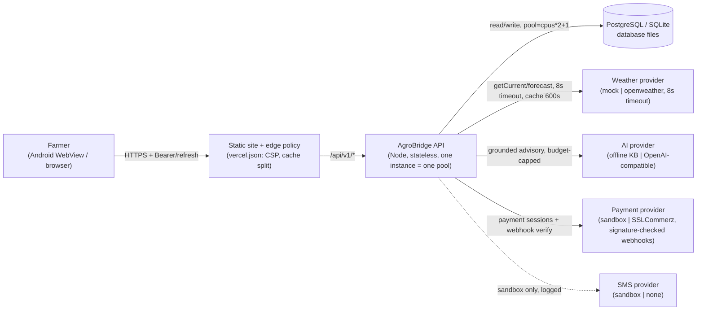
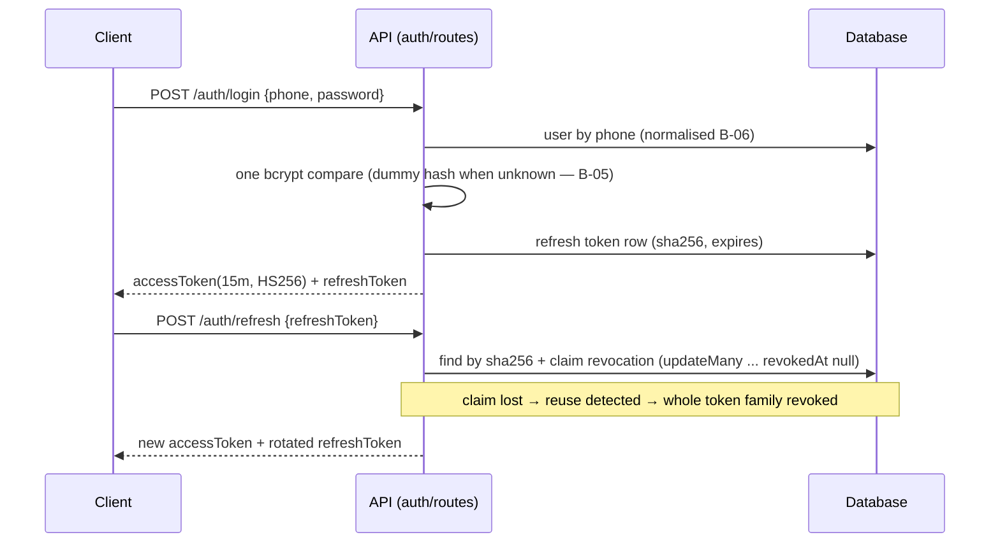

# Architecture

## System overview

```
Farmer / Admin / B2B (React SPA, bn/en)
        │  HTTPS, JWT bearer
        ▼
AgroBridge API  (Express + TypeScript, modular monolith)
 ├── middleware: request-id → helmet → cors → rate-limit → auth(JWT+status) → RBAC → zod validation → metrics
 ├── domains:
 │    identity · farms · weather · ai-agent · disease · marketplace
 │    services/bookings · procurement · payments/wallet · membership
 │    notifications · admin · audit · organizations (multi-tenant)
 ├── providers (swappable adapters):
 │    WeatherProvider      mock | openweather
 │    AIProvider           offline-agro-engine | openai-compatible (+fallback)
 │    PaymentProvider      sandbox | sslcommerz (live, signature-verified webhook)
 │    NotificationProvider in-app DB (+ SMS slot)
 │    StorageProvider      local FS | s3 (STORAGE_PROVIDER)
 ├── observability: /health, /ready, /metrics (prom-client), pino logs, requestId
 └── Prisma ORM
        ▼
SQLite (dev/test) ⇄ PostgreSQL (production target)
```

## Design decisions

1. **Modular monolith** with strict domain folders (`src/modules/*`). High-load domains can be
   extracted later without touching call sites because cross-domain access goes through the API layer.
2. **Provider abstraction everywhere** (weather/AI/payment/notification). Business logic never
   imports a concrete vendor SDK.
3. **Money as integers** (`*_Paisa`) to avoid float errors. Quantities are floats only for physical
   measures (kg, bigha).
4. **Transactional consistency** where it matters: checkout decrements stock and creates the order in
   a single Prisma transaction; procurement payout updates payment + wallet + ledger + PO atomically.
5. **Server-side authorization**: role→permission map in `middleware/rbac.ts`; resource ownership is
   enforced per-query (farmers' queries are always scoped to their own rows). **Multi-tenancy:** `Organization` + `OrganizationMember` join; farms carry `organizationId`; CORPORATE/COOPERATIVE see `OR(ownerId, organizationId in members)`; cross-tenant leakage proven absent by security-matrix tenant test.
6. **AI safety**: input sanitization, grounded retrieval, confidence thresholds with mandatory expert-
   verification notes, no direct action execution by the AI (orders/payments require explicit user flows).
7. **No fake production data**: demo/mock providers are selected explicitly via env; sandbox payment
   responses are labelled `providerMode: "sandbox"`; `sslcommerz` adapter implements signature verification and is only instantiated when creds present.
8. **Observability:** Prometheus `/metrics` (`agrobridge_http_requests_total`, `http_request_duration_seconds`, `db_up`, `ai_requests_total`, `payment_intents_total` + default process metrics) scraped by monitoring; alert rules in `docs/operations.md`.
9. **Storage abstraction:** `StorageProvider` interface + `LocalStorageProvider`; disease images via `getStorageProvider()` — prod can switch to S3 without code change (see `STORAGE_PROVIDER`).

## Architecture Decision Records (`docs/adr/`)

- [0001 — Marketplace catalog is login-gated by design](adr/ADR-0001-login-gated-marketplace-catalog.md)
- [0002 — Hand-rolled web data layer](adr/0002-hand-rolled-data-layer.md) (`api()` + `useResource`, no query library)
- [0003 — Token storage in localStorage](adr/0003-token-storage-in-localstorage.md) (accepted XSS risk; cookie migration trigger)
- [0004 — Dual-dialect Prisma](adr/0004-dual-dialect-prisma.md) (SQLite dev / PostgreSQL prod; every schema copy must be updated)
- [0005 — Provider adapters](adr/0005-provider-adapters.md) (weather/AI/payment/storage; `ALLOW_PLACEHOLDER_PROVIDERS` fail-fast)
- [0006 — Version single source](adr/0006-version-single-source.md) (`version.json`; `RELEASE_MANIFEST.md` is historical)
- [0007 — Schema state in the release contract](adr/0007-schema-state-in-release-contract.md) (`/ready` reports the applied migration chain; the deploy gate compares it)
- [0008 — Static site edge policy](adr/0008-static-site-edge-policy.md) (CSP by hash, cache split, build-time preflight)
- [0009 — Offline sync policy](adr/0009-offline-sync-policy.md) (write queue allow-list, `clientUuid` idempotency, owner-scoped replay)
- [0010 — Job durability](adr/0010-job-durability.md) (no server-side queue; Redis is rate-limit-only and fails open)
- [0012 — Payment provider dual mode](adr/0012-payment-provider-dual-mode.md) (sandbox/live boundary is fail-closed and labelled)
- [0013 — Hosting topology](adr/0013-hosting-topology-single-region.md) (Vercel + Neon, one region, runtime contract page)
- [0014 — Contract strategy](adr/0014-contract-strategy-and-generated-inventories.md) (generated inventories, response contract, idempotency keys)
- [0015 — Row-level security](adr/0015-row-level-security.md) (app-level scoping enforced now; RLS prototype planned)
- [0016 — OpenAPI deferral and doc freshness](adr/0016-openapi-deferral-and-doc-freshness.md) (generated docs with freshness gates)

## System shape (C4-style container view)

The farmer's phone (`apps/web`, a Vite-built SPA served as a static site and
wrapped by Capacitor for Android) talks to one stateless API. The API is the
only process that touches the database; every component boundary below is drawn
exactly where a network hop or a process boundary exists in the deployed system
(source of truth: `docker-compose.yml`, `vercel.json`, `apps/api/src/app.ts`).



*Caption:* boundaries as deployed — `apps/web` static host → `/api/v1/*` on the
API → `src/lib/prisma.ts` (single PrismaClient, pool per `DATABASE_CONNECTION_LIMIT`)
→ the databases; provider adapters are `apps/api/src/providers/*`, each an
independent failure domain (timeouts set per adapter,
`tests/ai-provider-adapter`, `weather-*` suites).

## Login and refresh (sequence)



*Caption:* the rotation claim runs `updateMany` filtered on `revokedAt: null`
and demands `count === 1` (`apps/api/src/modules/auth/routes.ts` /refresh) — the
reuse-detection that `journey-auth` tests exercise.

## Checkout idempotency (sequence)

```mermaid
sequenceDiagram
  participant C as Client
  participant A as API (orders/checkout)
  participant D as Database (transaction)
  C->>A: POST /orders/checkout {clientRequestId or Idempotency-Key}
  A->>D: find order by (userId, clientRequestId)
  alt replay
    A-->>C: the SAME order (200), no stock move
  else first submit
    A->>D: BEGIN; create order; decrement stock (conditional updateMany); COMMIT
    A-->>C: 201 order
  end
```

*Caption:* the duplicate-submit safety lives in
`ordersRouter.post("/checkout")` (`apps/api/src/modules/marketplace/routes.ts`):
the replay lookup runs before any stock change; parallel submits are pinned by
`checkout-idempotency` and `payment-confirm-webhook-race` suites.
