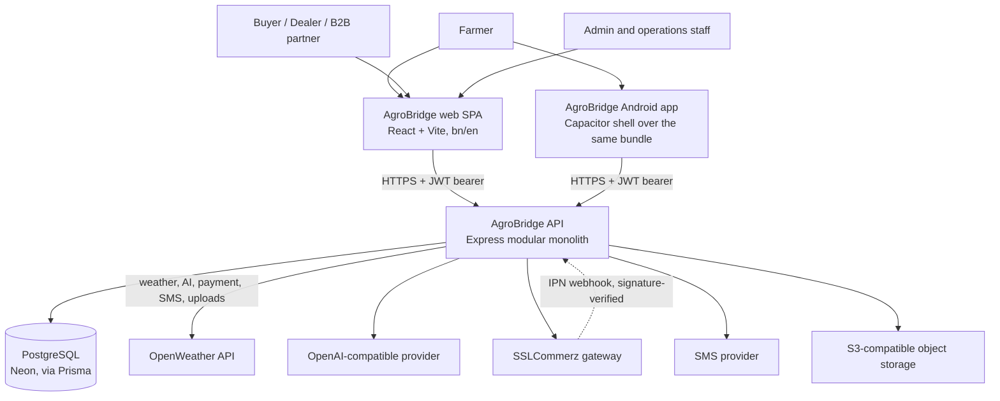
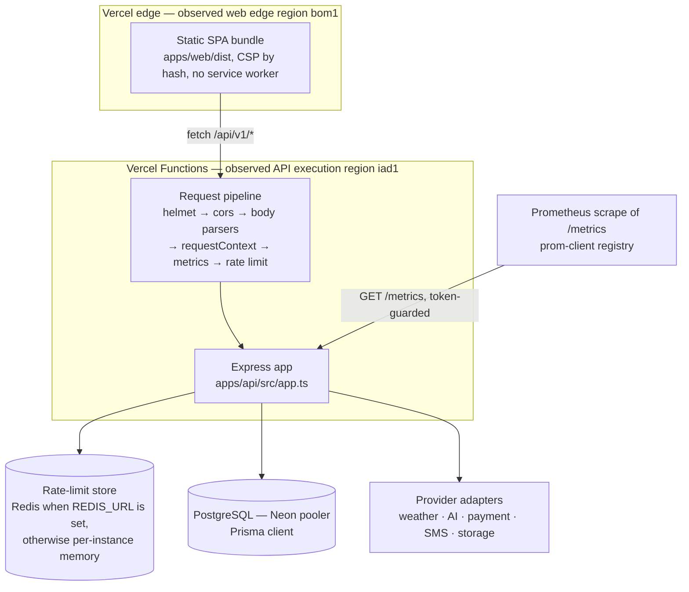
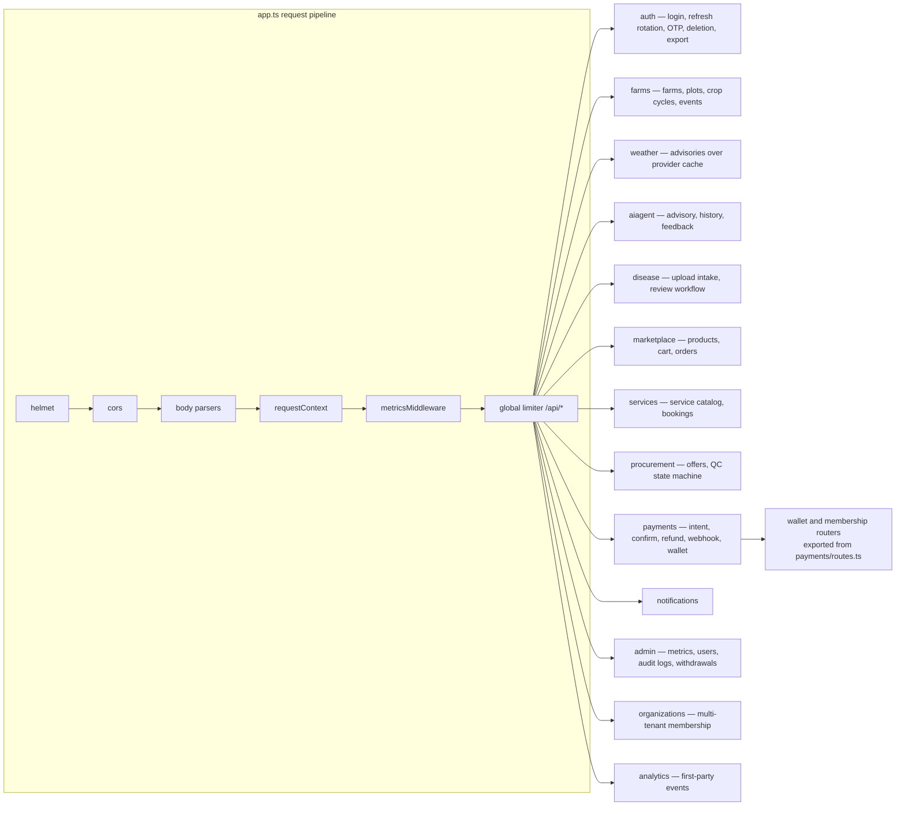
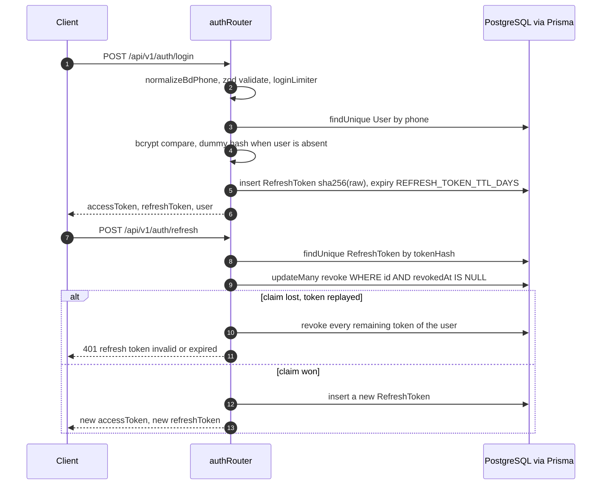
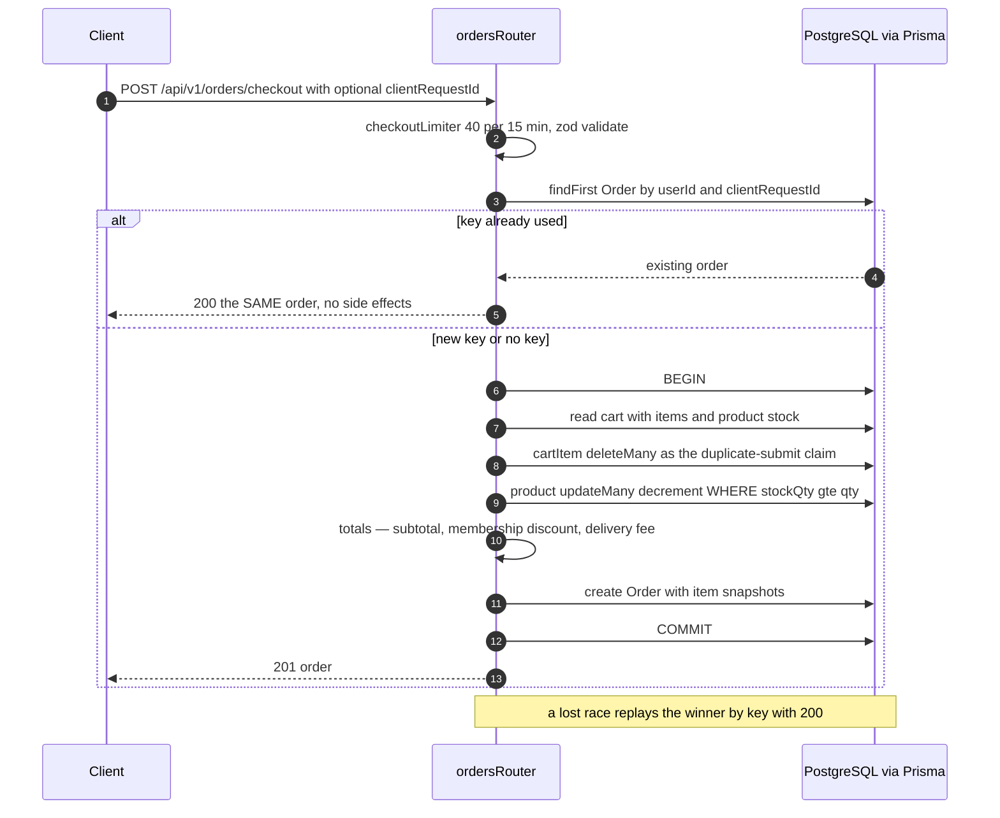
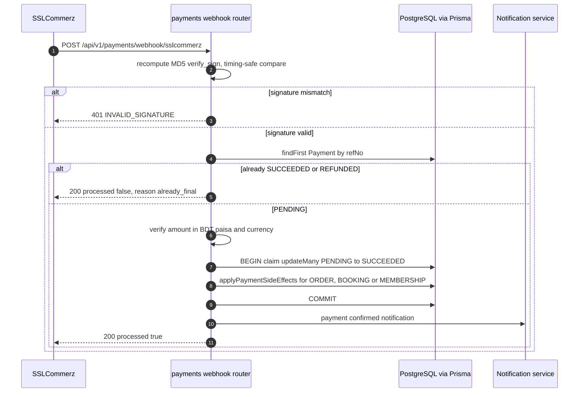
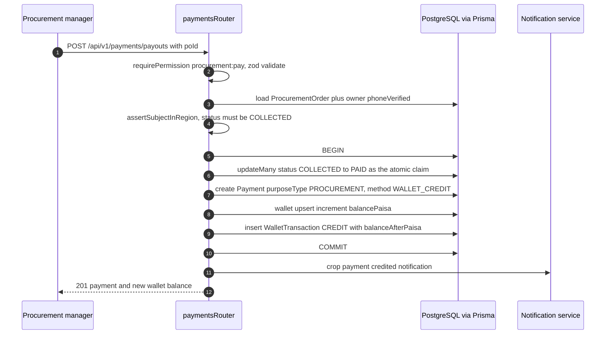
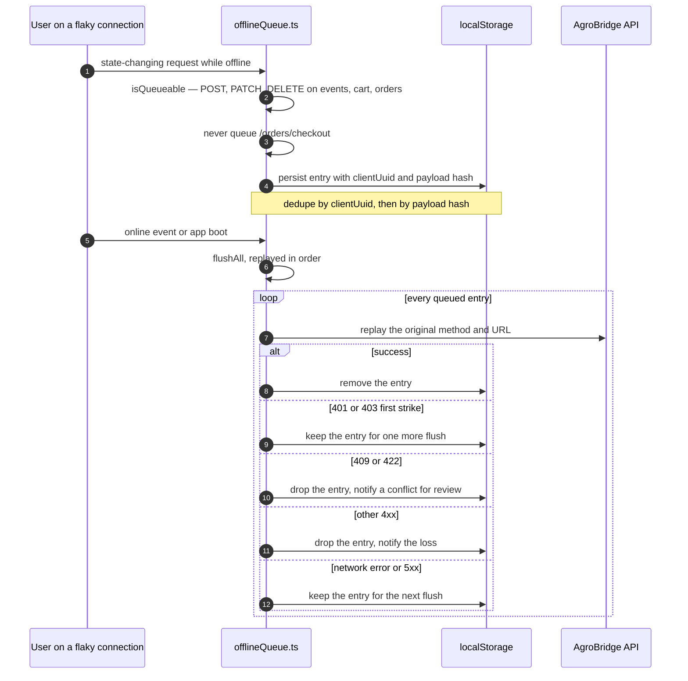
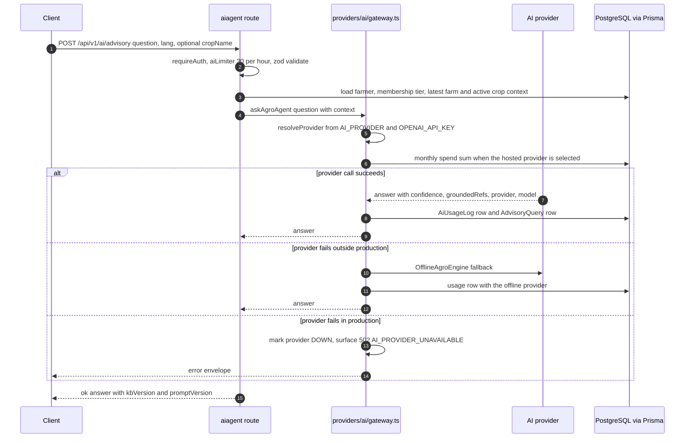

# Architecture

> **Owner:** engineering · **Purpose:** as-built system design and the ADR index · **Last verified:** 2026-10-19 (branch `audit/v2-remediation`; re-verify with the claims/link checks in CI).


See also: [threat-model.md](threat-model.md) · [slo.md](slo.md) · [runtime-contract.md](runtime-contract.md)
· [business-rules.md](business-rules.md) · [STATUS.md](STATUS.md).

## System overview

```
Farmer / Buyer / Admin / B2B partner
   ├── React SPA (bn/en, Vite)        apps/web         — static bundle on the Vercel edge
   └── Android app via Capacitor      apps/web/android — the same bundle in a WebView shell
        │  HTTPS, JWT bearer (access 15 min, rotating refresh 7 d)
        ▼
AgroBridge API  (Express + TypeScript, modular monolith, apps/api)
 ├── request pipeline (app.ts): helmet → cors → json 1 MB / urlencoded 200 kB
 │        → requestContext (X-Request-Id) → metricsMiddleware → rate limit /api/*
 │        → routers (per-router requireAuth → requirePermission → validate)
 ├── modules: auth · farms · weather · aiagent · disease · marketplace · services
 │        · procurement · payments · notifications · admin · organizations · analytics
 │        (membership is a service; membershipRouter is exported by payments/routes.ts)
 ├── providers (swappable adapters):
 │    WeatherProvider      mock | openweather
 │    AIProvider           offline-agro-engine | openai-compatible (offline fallback outside production)
 │    PaymentProvider      sandbox | sslcommerz (signature-verified webhook only)
 │    NotificationProvider in-app DB (+ SMS slot)
 │    StorageProvider      local | s3 | db (STORAGE_PROVIDER)
 ├── observability: /health, /ready, /metrics (prom-client), pino logs, requestId
 └── Prisma ORM
        ▼
SQLite (dev/test) · PostgreSQL (production, Neon — see docs/runbooks/live-deployment.md)
```

The pipeline order above is `apps/api/src/app.ts:57-87,133-151`; it is the corrected form of the
previously documented order (`request-id → helmet → cors → rate-limit → auth → RBAC → validation
→ metrics`), which did not match the code: the body parsers run before `requestContext`, both run
before `metricsMiddleware`, the rate limiter is mounted only on `/api/*`, and auth/RBAC/validation
are per-route middleware inside each module router rather than a global chain.

## C4 level 1 — System context



Source of truth: `apps/api/src/app.ts` (mounts, pipeline), `apps/web/src/lib/api.ts` (client base
URL), `apps/api/src/providers/*/index.ts` (provider selection).

## C4 level 2 — Containers



Region evidence: live `X-Vercel-Id: bom1::iad1::…` (`.audit/evidence/E-V2-live-probes.txt:40`);
platform limits and the absence of `maxDuration`/`regions` config are documented in
[runtime-contract.md](runtime-contract.md).

## C4 level 3 — API components (sketch)



Module directories: `apps/api/src/modules/*` (admin, aiagent, analytics, auth, disease, farms,
marketplace, membership, notifications, organizations, payments, procurement, services, weather).
`membership` contains only `service.ts`; the membership router is exported from
`apps/api/src/modules/payments/routes.ts`.

## Sequence diagrams

Each diagram's source of truth is the file named in its caption; runbook-level operational steps
live in `docs/runbooks/`.

### Login and refresh-token rotation



Source of truth: `apps/api/src/modules/auth/routes.ts:168-224` (login at 168, rotation claim at
206-218, reuse detection at 211-216).

### Checkout and idempotency



Source of truth: `apps/api/src/modules/marketplace/routes.ts:341-482` (replay lookup at 341-343,
checkout handler at 356, cart claim at 392-395, stock decrement at 400-408, totals at 411-413,
lost-race replay at 470-478).

### Payment confirm and gateway webhook



Source of truth: `apps/api/src/modules/payments/webhook.ts:26-110` (signature at 36-43, amount
check at 60-72, claim at 85-92). The sandbox confirm path (`POST /payments/:id/confirm`) funnels
through the same `claimAndApplyPayment` claim in `apps/api/src/modules/payments/routes.ts:217-251`.

### Procurement payout



Source of truth: `apps/api/src/modules/payments/routes.ts:461-539` (atomic claim at 484-490,
wallet credit and ledger at 504-519).

### Offline sync replay



Source of truth: `apps/web/src/lib/offlineQueue.ts:199-243` (allow-list at 25-43, enqueue dedupe
at 154-180, flush semantics at 199-235).

### AI advisory



Source of truth: `apps/api/src/modules/aiagent/routes.ts:33-80` and
`apps/api/src/providers/ai/gateway.ts:38-90` (budget guard at 25-31, fallback only outside
production at 70-88).

## Design decisions

1. **Modular monolith** with strict domain folders (`src/modules/*`). High-load domains can be
   extracted later without touching call sites because cross-domain access goes through the API layer.
2. **Provider abstraction everywhere** (weather/AI/payment/notification/storage). Business logic never
   imports a concrete vendor SDK: adapters use `fetch` directly
   (`apps/api/src/providers/ai/openai-compat.ts:163`, `apps/api/src/providers/weather/openweather.ts:13`).
3. **Money as integers** (`*_Paisa`) to avoid float errors. Quantities are floats only for physical
   measures (kg, bigha).
4. **Transactional consistency** where it matters: checkout decrements stock and creates the order in
   a single Prisma transaction; procurement payout updates payment + wallet + ledger + PO atomically.
5. **Server-side authorization**: role→permission map in `middleware/rbac.ts`; resource ownership is
   enforced per-query (farmers' queries are always scoped to their own rows). **Multi-tenancy:** `Organization` + `OrganizationMember` join; farms carry `organizationId`; CORPORATE/COOPERATIVE see `OR(ownerId, organizationId in members)`; cross-tenant leakage proven absent by `apps/api/tests/tenant-isolation.test.ts`.
6. **AI safety**: input sanitization, grounded retrieval, confidence thresholds with mandatory expert-
   verification notes, no direct action execution by the AI (orders/payments require explicit user flows).
   The offline fallback to `OfflineAgroEngine` is a non-production path only; production surfaces
   `AI_PROVIDER_UNAVAILABLE` instead of silently degrading (`apps/api/src/providers/ai/gateway.ts:70-83`).
7. **No fake production data**: demo/mock providers are selected explicitly via env; sandbox payment
   responses are labelled `providerMode: "sandbox"`; `sslcommerz` adapter implements signature verification and is only instantiated when creds present.
8. **Observability:** Prometheus `/metrics` with metric names as actually registered —
   `agrobridge_http_requests_total`, `agrobridge_http_request_duration_seconds`, `agrobridge_db_up`,
   `agrobridge_ai_requests_total`, `agrobridge_payment_intents_total` plus default process metrics
   (`apps/api/src/infrastructure/metrics.ts:6-38`). Alert rules are materialized in
   `monitoring/alert_rules.yml` (narrated in `docs/operations.md`).
9. **Storage abstraction:** `StorageProvider` interface with `local | s3 | db` implementations
   (`apps/api/src/providers/storage/index.ts`); disease images via `getStorageProvider()` — `db` is the
   production default because instance-disk uploads are lost on redeploy (ADR-0012).

## Architecture Decision Records (`docs/adr/`)

- [0001 — Marketplace catalog is login-gated by design](adr/ADR-0001-login-gated-marketplace-catalog.md)
- [0002 — Hand-rolled web data layer](adr/0002-hand-rolled-data-layer.md) (`api()` + `useResource`, no query library)
- [0003 — Token storage in localStorage](adr/0003-token-storage-in-localstorage.md) (accepted XSS risk; cookie migration trigger)
- [0004 — Dual-dialect Prisma](adr/0004-dual-dialect-prisma.md) (SQLite dev / PostgreSQL prod; every schema copy must be updated)
- [0005 — Provider adapters](adr/0005-provider-adapters.md) (weather/AI/payment/storage; `ALLOW_PLACEHOLDER_PROVIDERS` fail-fast)
- [0006 — Version single source](adr/0006-version-single-source.md) (`version.json`; `RELEASE_MANIFEST.md` is historical)
- [0007 — Schema state in the release contract](adr/0007-schema-state-in-release-contract.md) (`/ready` reports the applied migration chain; the deploy gate compares it)
- [0008 — Static site edge policy](adr/0008-static-site-edge-policy.md) (CSP by hash, cache split, build-time preflight)
- [0009 — Offline sync policy](adr/0009-offline-sync-policy.md) (write queue allow-list, `clientUuid` idempotency, owner-scoped replay)
- [0010 — Job durability](adr/0010-job-durability.md) (no server-side queue; Redis is rate-limit-only and fails open)
- [0011 — Data retention](adr/0011-data-retention.md) (financial rows retained; deletion anonymizes identity)
- [0012 — Durable uploads in the database](adr/0012-durable-uploads-in-database.md) (`STORAGE_PROVIDER=db`; the release gate rejects instance-disk uploads)
- [0013 — Admin/payout step-up decision](adr/0013-admin-payout-step-up-decision.md) (risk accepted with compensating controls; re-decide at the named triggers)
- [0014 — OpenAPI contract strategy](adr/0014-openapi-contract-strategy.md) (docs/api.md + the response-contract fixture are the gate; generated OpenAPI deferred with triggers)
- [0015 — Tenancy / RLS decision](adr/0015-tenancy-rls-decision.md) (application scoping now; RLS prototype plan with `SET LOCAL app.user_id`)
- [0016 — Payment provider selection](adr/0016-payment-provider-selection.md) (SSLCommerz; hosted checkout keeps PCI scope out; activation is an owner gate)
