# Entity relationship diagram

> Generated by `apps/api/scripts/generate-erd.mjs` — do not edit.
> Regenerate: `node apps/api/scripts/generate-erd.mjs`.
> Drift gate: `apps/api/tests/generated-docs-freshness.test.ts` compares this file with a fresh in-memory render.

Source: `apps/api/prisma/postgres/schema.prisma` (the canonical PostgreSQL schema; ADR-0004 keeps the SQLite variant in step for local/test runs).

```mermaid
erDiagram
  Cart ||--o{ CartItem : "items"
  CropCycle |o--o{ DiseaseCase : "diseaseCases"
  CropCycle |o--o{ FarmEvent : "farmEvents"
  Farm ||--o{ Booking : "bookings"
  Farm ||--o{ FarmEvent : "farmEvents"
  Farm ||--o{ Plot : "plots"
  Farm ||--o{ ProcurementOrder : "procurementOrders"
  Order ||--o{ OrderItem : "items"
  Organization |o--o{ Farm : "farms"
  Organization ||--o{ OrganizationMember : "members"
  Plot ||--o{ CropCycle : "cropCycles"
  Plot |o--o{ FarmEvent : "farmEvents"
  Product ||--o{ CartItem : "cartItems"
  Product ||--o{ OrderItem : "orderItems"
  Service ||--o{ Booking : "bookings"
  ServiceProvider |o--o{ Booking : "bookings"
  Service ||--o{ ServiceProvider : "providers"
  User ||--o{ AdvisoryQuery : "advisoryQueries"
  User |o--o{ AiUsageLog : "aiUsageLogs"
  User |o--o{ AnalyticsEvent : "analyticsEvents"
  User |o--o{ AuditLog : "auditLogs"
  User ||--o{ Booking : "bookings"
  User ||--o{ Cart : "user"
  User ||--o{ DiseaseCase : "diseaseCases"
  User ||--o{ Farm : "farms"
  User ||--o{ FarmerProfile : "user"
  User ||--o{ Notification : "notifications"
  User ||--o{ Order : "orders"
  User ||--o{ OrganizationMember : "organizationMembers"
  User ||--o{ OtpChallenge : "otpChallenges"
  User ||--o{ Payment : "payments"
  User ||--o{ ProcurementOrder : "procurementOrders"
  User ||--o{ RefreshToken : "refreshTokens"
  User |o--o{ ServiceProvider : "userId (scalar FK)"
  User ||--o{ Wallet : "user"
  User ||--o{ WalletTransaction : "userId (scalar FK)"
  User ||--o{ Withdrawal : "withdrawals"
  User {
    string id PK
    string phone
    string email
    string passwordHash
    string fullName
    string role "SUPER_ADMIN|ADMIN|REGIONAL_MANAGER|AREA_MANAGER|FIELD_AGENT|COLLECTION_MANAGER|WAREHOUSE_MANAGER|PROCUREMENT_MANAGER|SERVICE_PROVIDER|DEALER|CORPORATE|COOPERATIVE|FARMER"
    string langPref "bn|en"
    string status "ACTIVE|SUSPENDED|DISABLED"
    string region "territory scope for manager roles (e.g., DHAKA_NORTH)"
    boolean phoneVerified
    string notificationPrefs "JSON (critical:boolean,action:boolean,info:boolean)"
    datetime createdAt
    datetime updatedAt
  }
  RefreshToken {
    string id PK
    string userId FK
    string tokenHash
    datetime expiresAt
    datetime revokedAt
    string deviceInfo
    datetime createdAt
  }
  FarmerProfile {
    string id PK
    string userId FK
    string nidLast4
    string address
    string district
    string upazila
    string membershipTier "BRONZE|SILVER|GOLD"
    datetime membershipExpiresAt
    datetime joinedAt
  }
  Farm {
    string id PK
    string ownerId FK
    string organizationId FK
    string name
    string address
    string district
    string upazila
    float lat
    float lng
    float totalAreaBigha
    string status
    datetime createdAt
    datetime updatedAt
  }
  Plot {
    string id PK
    string farmId FK
    string name
    float areaBigha
    string soilType
    string irrigationType
    datetime createdAt
    datetime updatedAt
  }
  CropCycle {
    string id PK
    string plotId FK
    string cropName
    string variety
    datetime plantedAt
    datetime expectedHarvestAt
    string stage "SEED|GERMINATION|VEGETATIVE|FLOWERING|GRAIN_FRUIT_DEVELOPMENT|HARVEST"
    string status "ACTIVE|HARVESTED|FAILED"
    float yieldKg
    datetime createdAt
    datetime updatedAt
  }
  FarmEvent {
    string id PK
    string clientUuid "offline sync idempotency"
    string farmId FK
    string plotId FK
    string cropCycleId FK
    string actorId
    string type "PLANTING|SEED|FERTILIZER|IRRIGATION|PEST|DISEASE|SERVICE|HARVEST|OTHER"
    string title
    string notes
    string metadataStr "JSON-serialized metadata (validated at API layer)"
    datetime occurredAt
    string source "APP|SYNC|ADMIN"
    datetime createdAt
  }
  AdvisoryQuery {
    string id PK
    string userId FK
    string question
    string answer
    float confidence
    string provider
    string model
    boolean lowConfidenceFlag
    string groundedRefs "JSON array of KB refs"
    string feedbackReason "farmer feedback: why the answer was not useful (A7-07)"
    datetime feedbackAt "when the feedback was submitted (A7-07)"
    datetime createdAt
    string kbVersion "KB corpus version(s) that grounded this answer"
    string promptVersion "hosted prompt-template version, when applicable"
    string requestId "request correlation id (X-Request-Id)"
  }
  DiseaseCase {
    string id PK
    string userId FK
    string cropCycleId FK
    string imagePath
    string cropGuess
    string diagnosis
    float confidence
    string severity "LOW|MODERATE|HIGH"
    string recommendation
    string status "AI_ONLY|PENDING_REVIEW|REVIEWED"
    string reviewedBy
    datetime reviewedAt
    datetime createdAt
  }
  Product {
    string id PK
    string sku
    string name
    string category "SEED|FERTILIZER|BIO_INPUT|CROP_PROTECTION|EQUIPMENT"
    string description
    string unit
    int pricePaisa
    int stockQty
    string batchNo
    datetime expiryDate
    string supplier
    string cropRelevance
    boolean isActive
    datetime createdAt
    datetime updatedAt
  }
  Cart {
    string id PK
    string userId FK
    datetime createdAt
    datetime updatedAt
  }
  CartItem {
    string id PK
    string cartId FK
    string productId FK
    int qty
  }
  Order {
    string id PK
    string orderNo
    string userId FK
    string status "PENDING|CONFIRMED|PAID|SHIPPED|DELIVERED|CANCELLED"
    int subtotalPaisa
    int discountPaisa
    int deliveryFeePaisa
    int totalPaisa
    string paymentStatus "UNPAID|PAID|REFUNDED"
    string shippingName
    string shippingPhone
    string shippingAddress
    string cancelReason
    string clientRequestId "client-supplied checkout idempotency key (AUD-125)"
    datetime createdAt
    datetime updatedAt
  }
  OrderItem {
    string id PK
    string orderId FK
    string productId FK
    string nameSnapshot
    string skuSnapshot
    int unitPricePaisa
    int qty
  }
  Service {
    string id PK
    string code
    string name
    string category "DRONE|TRACTOR|COMBINE_HARVESTER|RICE_TRANSPLANTER|POWER_TILLER|LAND_LEVELLER|THRESHER|SOIL_TESTING|AGRONOMIST|OTHER"
    int basePricePaisa
    string priceUnit
    string description
    boolean isActive
  }
  ServiceProvider {
    string id PK
    string serviceId FK
    string userId
    string name
    string phone
    string district
    int ratingSum
    int ratingCount
    boolean isActive
  }
  Booking {
    string id PK
    string bookingNo
    string userId FK
    string farmId FK
    string serviceId FK
    string providerId FK
    datetime scheduledFor
    float areaBigha
    int estimatedPricePaisa
    string status "REQUESTED|ASSIGNED|IN_PROGRESS|COMPLETED|CANCELLED"
    string paymentStatus
    int rating
    string cancelReason
    datetime completedAt
    datetime createdAt
    datetime updatedAt
  }
  ProcurementOrder {
    string id PK
    string poNo
    string userId FK
    string farmId FK
    string cropName
    float quantityKg
    float moisturePct
    string qualityGrade "A|B|C"
    int basePricePerKgPaisa
    int deductionsPaisa
    int netPayablePaisa
    string status "SUBMITTED|QC|PURCHASE_ORDER|COLLECTED|PAID|REJECTED|CANCELLED"
    string notes
    string qcNotes
    datetime createdAt
    datetime updatedAt
  }
  Payment {
    string id PK
    string refNo
    string userId FK
    string purposeType "ORDER|BOOKING|PROCUREMENT|MEMBERSHIP"
    string purposeId
    int amountPaisa
    string method "MOBILE_WALLET|CARD|BANK|WALLET_CREDIT"
    string providerRef
    string status "PENDING|SUCCEEDED|FAILED|REFUNDED"
    datetime refundedAt
    string refundRef
    string metaStr
    datetime createdAt
    string requestId "request correlation id (X-Request-Id) for support/audit joins"
    datetime updatedAt
  }
  Wallet {
    string id PK
    string userId FK
    int balancePaisa
    int heldPaisa
  }
  WalletTransaction {
    string id PK
    string userId
    string direction "CREDIT|DEBIT"
    int amountPaisa
    string reason
    int balanceAfterPaisa
    string refType
    string refId
    datetime createdAt
  }
  Withdrawal {
    string id PK
    string refNo
    string userId FK
    int amountPaisa
    string status "PENDING|APPROVED|REJECTED|PAID"
    string channel "BKASH|NAGAD|BANK"
    string destination "masked payout destination (e.g., 017***4567)"
    string note
    string decidedBy
    datetime decidedAt
    datetime createdAt
    datetime updatedAt
  }
  OtpChallenge {
    string id PK
    string userId FK
    string phone
    string codeHash
    string purpose
    int attempts
    datetime consumedAt
    datetime expiresAt
    datetime createdAt
  }
  AnalyticsEvent {
    string id PK
    string name
    string userId FK
    string sessionId
    string propsStr
    datetime createdAt
  }
  MembershipPlan {
    string id PK
    string tier "BRONZE|SILVER|GOLD"
    int pricePaisa
    int durationDays
    string benefitsStr "JSON array of benefit strings; configurable from admin"
    boolean isActive
  }
  Notification {
    string id PK
    string userId FK
    string type "SYSTEM|ORDER|BOOKING|PROCUREMENT|PAYMENT|WEATHER|AI|MEMBERSHIP"
    string category "CRITICAL|ACTION|INFO"
    string title
    string body
    datetime readAt
    string refType
    string refId
    datetime createdAt
  }
  AuditLog {
    string id PK
    string actorId FK
    string action
    string entityType
    string entityId
    string ip
    string metaStr
    datetime createdAt
  }
  AiUsageLog {
    string id PK
    string userId FK
    string provider
    string model
    int tokensIn
    int tokensOut
    int costEstimatePaisa
    int latencyMs
    boolean success
    datetime createdAt
    string requestId
    string kbVersion
  }
  Organization {
    string id PK
    string name
    string type "COOPERATIVE | CORPORATE | NGO | GOVT"
    string district
    datetime createdAt
    datetime updatedAt
  }
  OrganizationMember {
    string id PK
    string organizationId FK
    string userId FK
    string role "ADMIN | MEMBER | VIEWER"
    datetime createdAt
  }
  StoredObject {
    string id PK
    string key "storage key returned by save(), e.g. uploads/disease/<file>"
    string mime
    int sizeBytes
    bytes data
    datetime createdAt
  }
  PendingUploadPurge {
    string id PK
    string key
    string context
    int attempts
    string lastError
    datetime createdAt
  }
  LoginAttempt {
    string phoneKey PK "salted sha256 of the normalized phone — no PII at rest"
    int count
    datetime lockedUntil
    datetime updatedAt
  }
```

Edges are declared Prisma relations plus `<model>Id` scalar columns marked `scalar FK` — real join paths without an enforced constraint. A leading `|o` on an edge means the foreign key is nullable.

## Models

| Model | Fields | Edges |
|---|---|---|
| `User` | 31 | 20 |
| `RefreshToken` | 8 | 1 |
| `FarmerProfile` | 10 | 1 |
| `Farm` | 19 | 6 |
| `Plot` | 11 | 3 |
| `CropCycle` | 14 | 3 |
| `FarmEvent` | 16 | 3 |
| `AdvisoryQuery` | 16 | 1 |
| `DiseaseCase` | 15 | 2 |
| `Product` | 17 | 2 |
| `Cart` | 6 | 2 |
| `CartItem` | 6 | 2 |
| `Order` | 18 | 2 |
| `OrderItem` | 9 | 2 |
| `Service` | 10 | 2 |
| `ServiceProvider` | 11 | 3 |
| `Booking` | 20 | 4 |
| `ProcurementOrder` | 18 | 2 |
| `Payment` | 16 | 1 |
| `Wallet` | 5 | 1 |
| `WalletTransaction` | 9 | 1 |
| `Withdrawal` | 13 | 1 |
| `OtpChallenge` | 10 | 1 |
| `AnalyticsEvent` | 7 | 1 |
| `MembershipPlan` | 6 | 0 |
| `Notification` | 11 | 1 |
| `AuditLog` | 9 | 1 |
| `AiUsageLog` | 13 | 1 |
| `Organization` | 8 | 2 |
| `OrganizationMember` | 7 | 2 |
| `StoredObject` | 6 | 0 |
| `PendingUploadPurge` | 6 | 0 |
| `LoginAttempt` | 4 | 0 |
